# Current-Run Motion-Regime Characterization

## Scope

This report characterizes method-estimated dense displacement fields, not
ground-truth physical motion. OASIS uses the seed-3 shuffled first10 protocol
with the fixed raw-image-positive foreground mask (`image > 0`). 4DCT uses the
fixed T00 lung mask on the cropped 1mm pTV-prep grid.

Primary methods are OASIS SINR cps4 alpha1000 and 4DCT IDIR default. Sensitivity
methods are OASIS DirectCP cps4 alpha1000 and 4DCT DirectCP 32-16-8-4.

## Organized Paper Table

| Dataset   | Role        | Method                        |   Mean disp mm |   P95 disp mm |   % >10mm |   Diffusion |    Bending |   logJ std |      J<=0 % |   Corr len mm |   Coarse E@16mm |   Coarse E@32mm |   Coarse E@64mm |
|:----------|:------------|:------------------------------|---------------:|--------------:|----------:|------------:|-----------:|-----------:|------------:|--------------:|----------------:|----------------:|----------------:|
| 4DCT      | primary     | 4DCT IDIR default             |        8.89263 |      18.8498  |  36.147   |   0.0649337 | 0.00157998 |   0.143202 | 2.44679e-05 |      64       |        0.997154 |       0.984082  |        0.921829 |
| OASIS     | primary     | OASIS SINR cps4 alpha1000     |        5.17604 |       9.9823  |   5.06497 |   1.62673   | 0.24221    |   3.23961  | 5.67839     |      11.5085  |        0.596436 |       0.178159  |       -0.067797 |
| 4DCT      | sensitivity | 4DCT DirectCP 32-16-8-4       |        8.87984 |      18.6391  |  36.0636  |   0.0921788 | 0.00695668 |   0.224892 | 0.0137162   |      64       |        0.99466  |       0.981828  |        0.941589 |
| OASIS     | sensitivity | OASIS DirectCP cps4 alpha1000 |        4.30795 |       8.50132 |   2.31726 |   1.60845   | 0.296232   |   3.24762  | 5.71858     |       9.12122 |        0.463692 |       0.0251185 |       -0.383856 |

## 4DCT / OASIS Contrast

| Role        | Contrast     | OASIS method                  | 4DCT method             |   Mean disp mm |   P95 disp mm |   % >10mm |   Diffusion |    Bending |   logJ std |      J<=0 % |   Corr len mm |   Coarse E@16mm |   Coarse E@32mm |   Coarse E@64mm |
|:------------|:-------------|:------------------------------|:------------------------|---------------:|--------------:|----------:|------------:|-----------:|-----------:|------------:|--------------:|----------------:|----------------:|----------------:|
| primary     | 4DCT / OASIS | OASIS SINR cps4 alpha1000     | 4DCT IDIR default       |        1.71804 |       1.88833 |   7.13666 |   0.0399167 | 0.00652318 |  0.0442034 | 4.30895e-06 |       5.56111 |         1.67185 |         5.52362 |       -13.5969  |
| sensitivity | 4DCT / OASIS | OASIS DirectCP cps4 alpha1000 | 4DCT DirectCP 32-16-8-4 |        2.06127 |       2.1925  |  15.563   |   0.0573092 | 0.0234839  |  0.0692482 | 0.00239854  |       7.01661 |         2.14509 |        39.0878  |        -2.45297 |

## Figures And Interpretation

### Figure 1: Primary Motion Amplitude

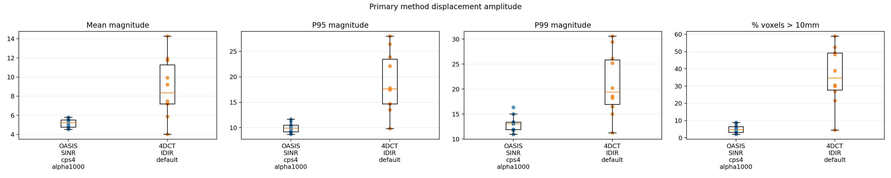

This plot compares displacement magnitude on the correct foreground masks. Large
4DCT amplitudes indicate respiratory-motion scale; OASIS amplitudes are smaller
but should be interpreted together with smoothness and coherence.

### Figure 2: Primary Smoothness And Jacobian Properties

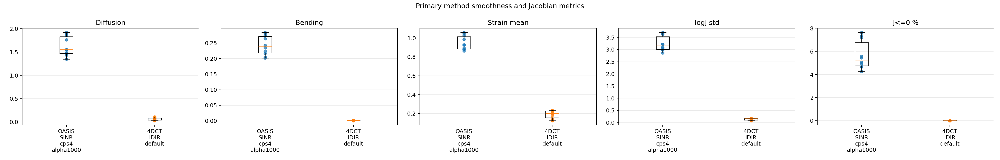

Diffusion, bending, strain, log-Jacobian spread, and folding quantify local
deformation burden. These metrics expose whether a large-amplitude field is
also locally irregular.

### Figure 3: Primary Spatial Coherence

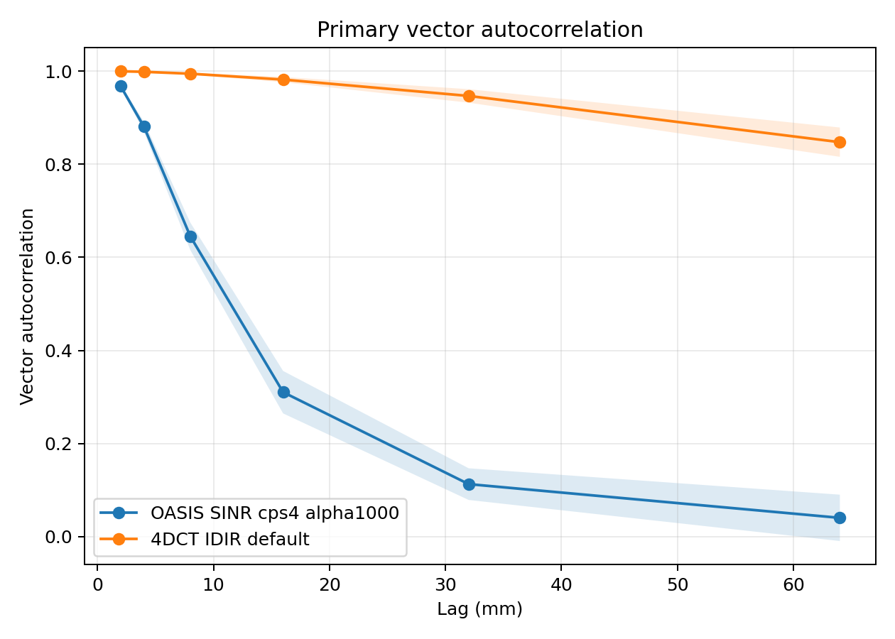

Vector autocorrelation over increasing lag summarizes spatial coherence. A
slowly decaying curve means motion remains coherent over larger physical
distances.

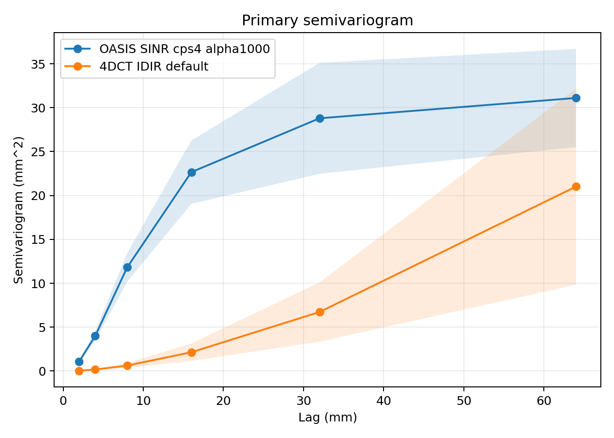

The semivariogram gives the complementary view: larger values at short lags
indicate stronger local variation.

### Figure 4: Primary Coarse-Grid Explainability

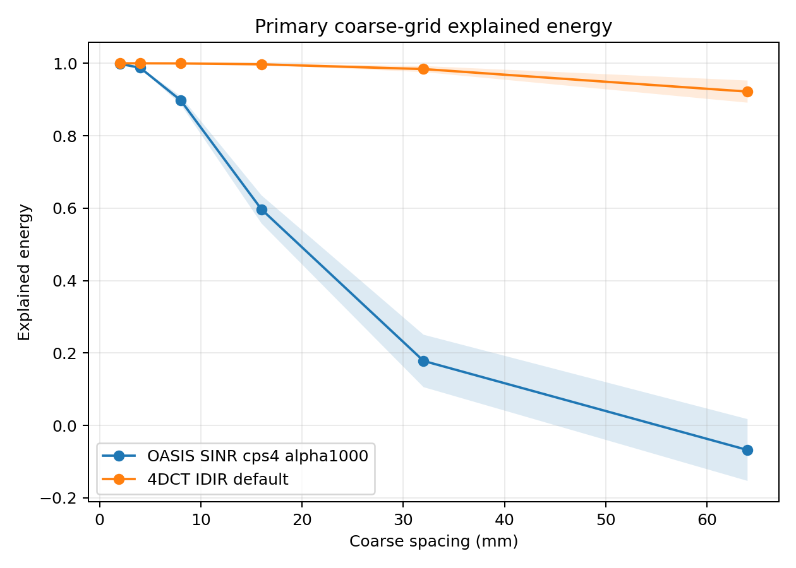

Coarse-grid explained energy asks how much of the displacement field can be
captured by local control sampled at coarse spacings. This is the most direct
off-grid/local-control proxy in this analysis.

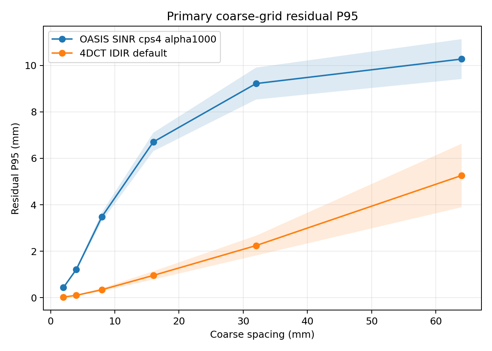

Residual P95 shows the magnitude of field content not captured at each coarse
spacing.

### Figure 5: Primary Low-Pass Explainability

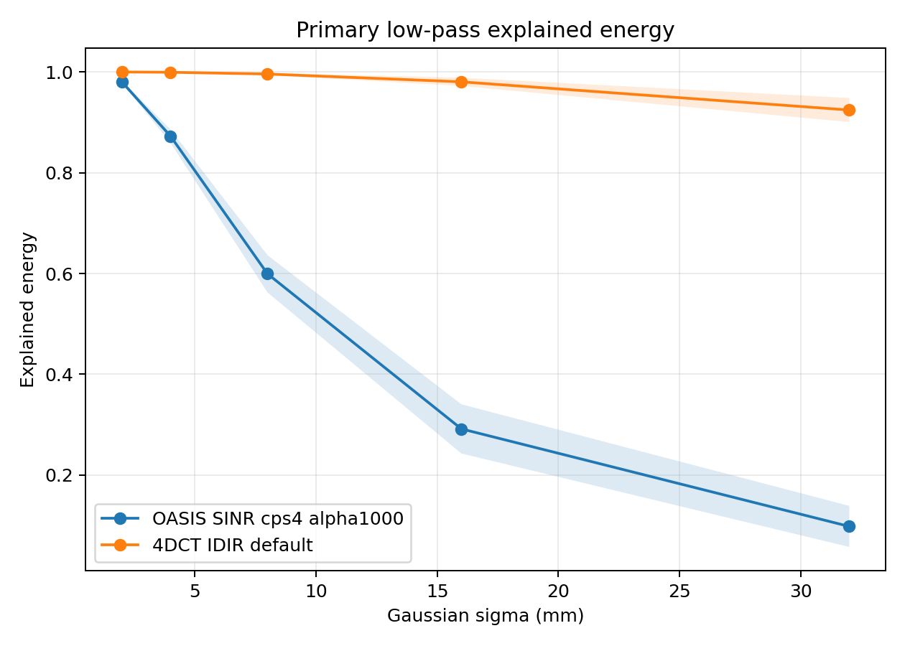

Gaussian low-pass explained energy separates broad smooth components from
higher-frequency local corrections.

### Figure 6: Representative Magnitude Slices

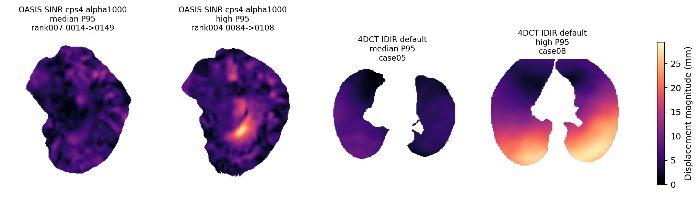

Slices are selected from median-P95 and high-P95 cases for each primary method.
The color scale is shared across displayed examples.

## Sensitivity Figures

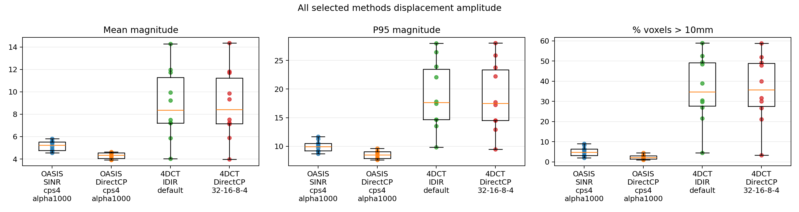

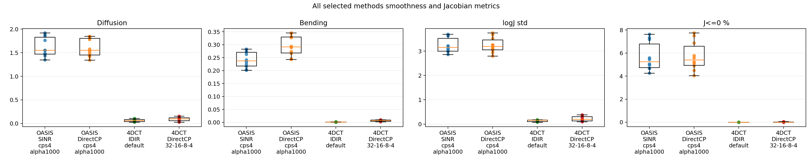

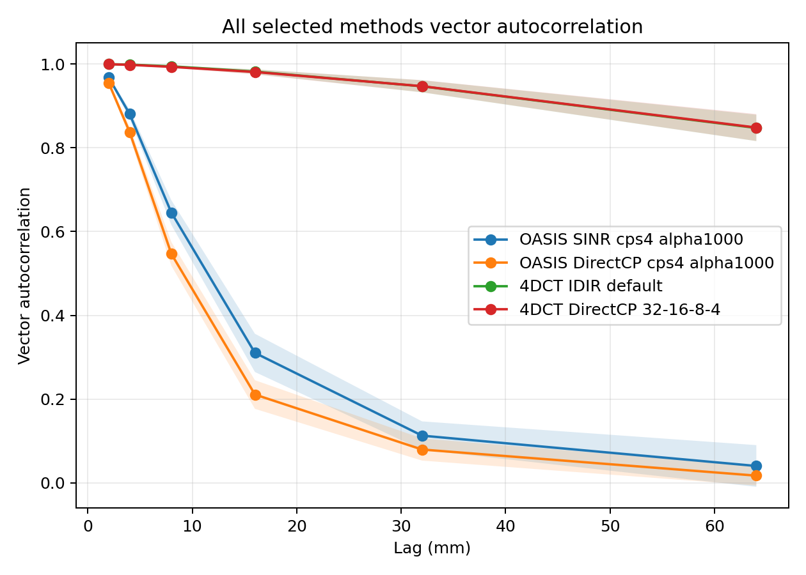

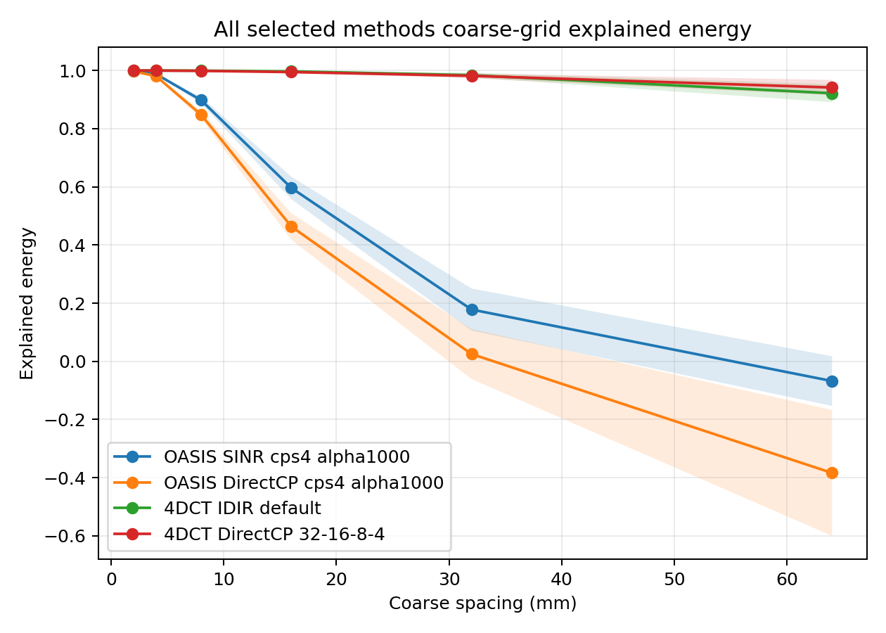

## Output Files

- `tables/case_metrics_comprehensive.csv`
- `tables/aggregate_metrics_comprehensive.csv`
- `tables/paper_table_organized.csv`
- `tables/contrast_table_4dct_over_oasis.csv`
- `curves/autocorrelation_curves.csv`
- `curves/lowpass_curves.csv`
- `curves/coarse_grid_curves.csv`
- `input_manifest.csv`
- `input_manifest_sha256.csv`
