# Population Fit-Modes Diagnostic Comparison

This report places all ten cases from each locked cohort on a common visual scale. Each thumbnail is a complete two-panel case diagnostic; select it to open the full-resolution figure.

## Reading the diagnostics

- Panel A is the full-image/full-crop registration diagnostic `1-NCC` on a logarithmic axis; lower is better.
- Panel B is supervised target-field fitting `rRMSE (%) = 100 × sqrt(MSE / (target power + 1e-12))` on a logarithmic axis; lower is better.
- All trajectories run to epoch 2500. Gray dotted lines mark MR-D-BSCP stage transitions; they do not apply to the single-stage methods.
- Axis limits are identical across all ten cases within each dataset and panel. They are locked in the manifest, not autoscaled per case.
- Some single-stage Panel B histories record the epoch-2500 loss immediately before the last optimizer update. Where it differs, the displayed terminal point uses the accepted full-mask post-update `summary.json` value; both raw and accepted endpoints remain in the curve summary.

## Shared axis definitions

| Dataset | Panel A: 1-NCC | Panel B: rRMSE (%) | Scope |
|---|---:|---:|---|
| OASIS | `0.001` to `0.5` | `0.1` to `1000` | shared by 10 cases |
| DIR-LAB | `0.001` to `0.5` | `0.1` to `1000` | shared by 10 cases |

## Open camera-ready schedule issue

| Dataset | Panel A MR-D-BSCP | Panel B MR-D-BSCP | Status |
|---|---|---|---|
| OASIS | `400/800/1300` = 2500 | `400/800/1300` = 2500 | schedule matched |
| DIR-LAB | `200/400/800/1000` = 2400 | `400/400/800/900` = 2500 | **not schedule/budget matched** |

The DIR-LAB discrepancy is part of the accepted protocols, not a plotting artifact. Until a replacement Panel A cohort is run, these results support final-spacing matching (`32-16-8-4`) but not identical schedules or equal Panel A budgets. The preferred camera-ready correction is tracked in [`camera_ready_checklist.md`](../../docs/todos/camera_ready_checklist.md).

## OASIS N=10

<table>
  <tr>
    <td align="center" width="20%">
      <strong>OASIS r0: M0115→F0333</strong> 
      <a href="diagnostic_figures/oasis_rank000_diagnostics.png">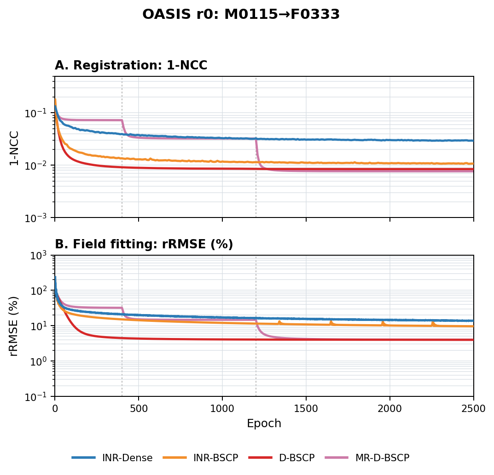</a>
    </td>
    <td align="center" width="20%">
      <strong>OASIS r1: M0017→F0113</strong> 
      <a href="diagnostic_figures/oasis_rank001_diagnostics.png">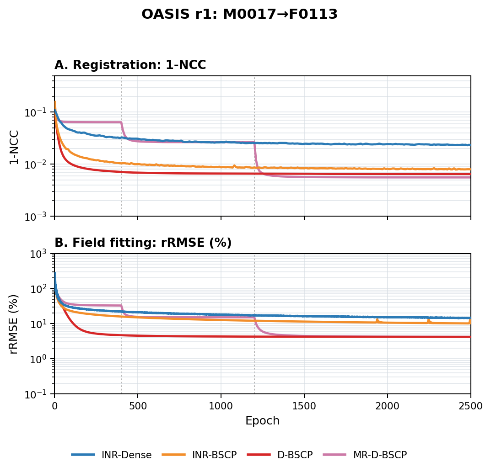</a>
    </td>
    <td align="center" width="20%">
      <strong>OASIS r2: M0394→F0037</strong> 
      
    </td>
    <td align="center" width="20%">
      <strong>OASIS r3: M0322→F0117</strong> 
      <a href="diagnostic_figures/oasis_rank003_diagnostics.png">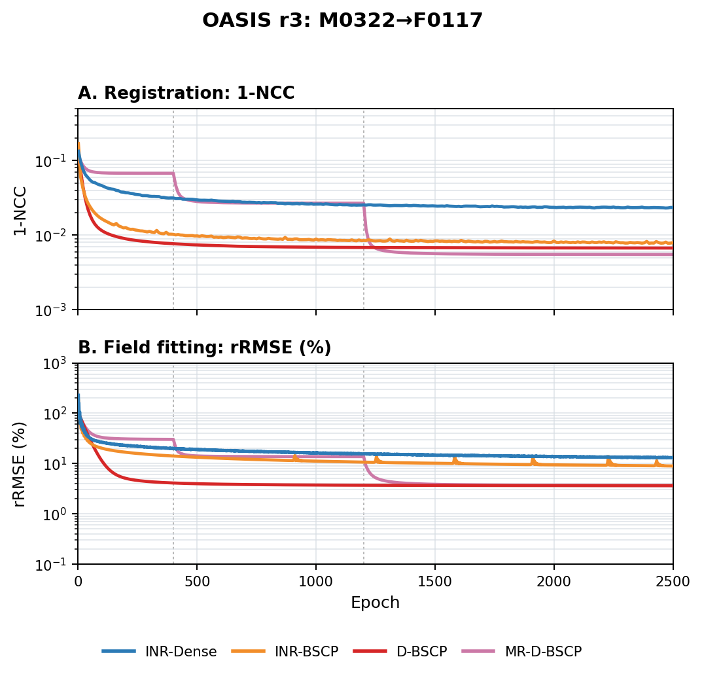</a>
    </td>
    <td align="center" width="20%">
      <strong>OASIS r4: M0108→F0084</strong> 
      <a href="diagnostic_figures/oasis_rank004_diagnostics.png">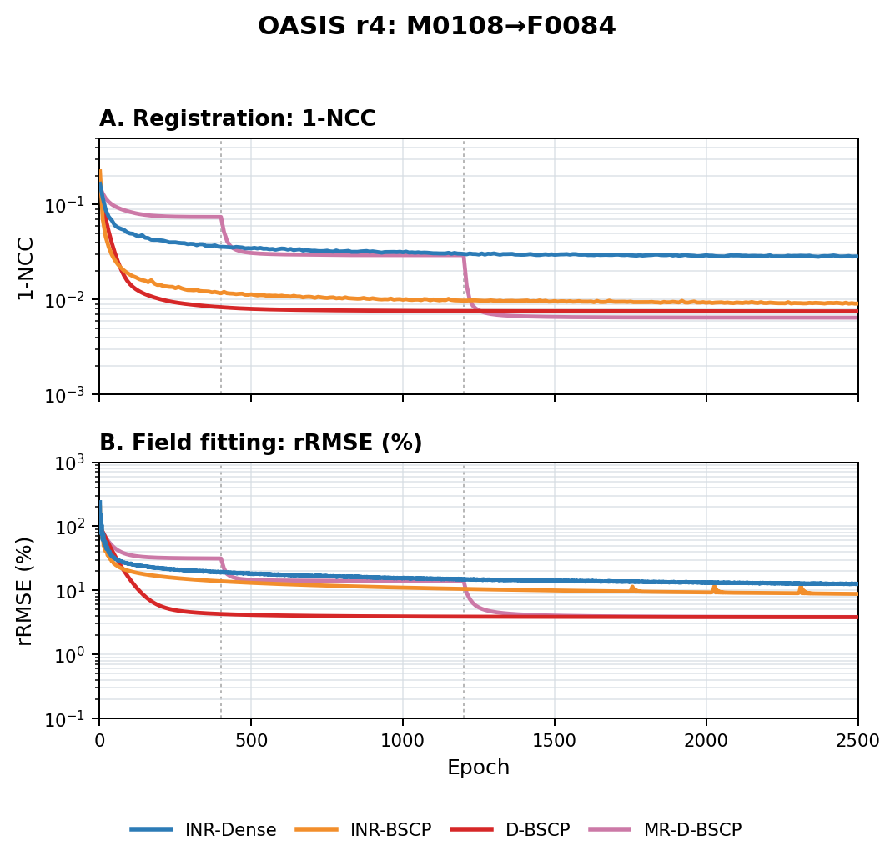</a>
    </td>
  </tr>
  <tr>
    <td align="center" width="20%">
      <strong>OASIS r5: M0024→F0288</strong> 
      <a href="diagnostic_figures/oasis_rank005_diagnostics.png">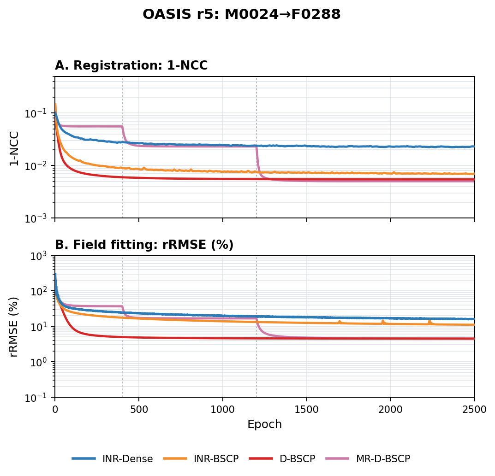</a>
    </td>
    <td align="center" width="20%">
      <strong>OASIS r6: M0184→F0194</strong> 
      <a href="diagnostic_figures/oasis_rank006_diagnostics.png">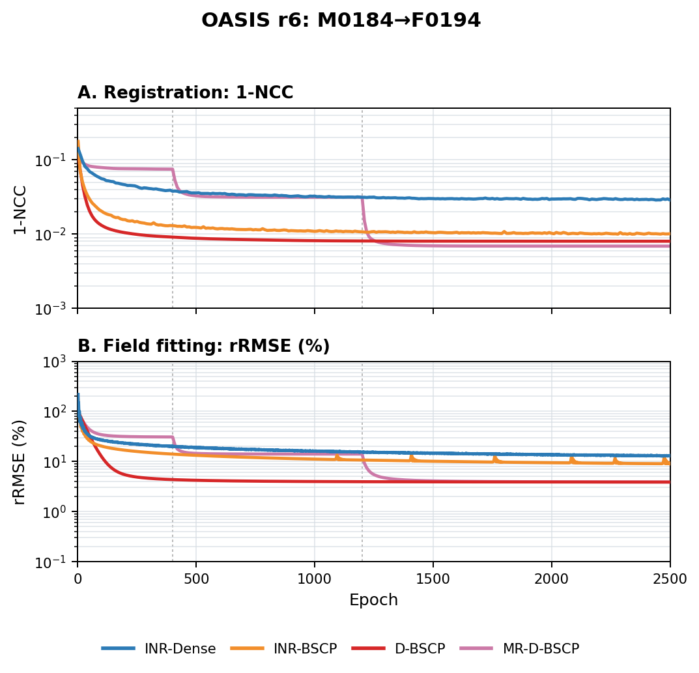</a>
    </td>
    <td align="center" width="20%">
      <strong>OASIS r7: M0149→F0014</strong> 
      <a href="diagnostic_figures/oasis_rank007_diagnostics.png">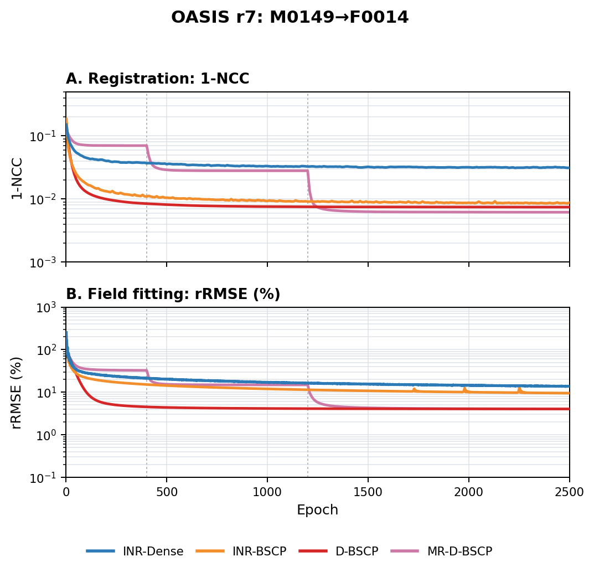</a>
    </td>
    <td align="center" width="20%">
      <strong>OASIS r8: M0326→F0215</strong> 
      
    </td>
    <td align="center" width="20%">
      <strong>OASIS r9: M0136→F0173</strong> 
      
    </td>
  </tr>
</table>

### Panel A endpoints: 1-NCC

| Case | INR-Dense | INR-BSCP | D-BSCP | MR-D-BSCP |
|---|---:|---:|---:|---:|
| OASIS r0: M0115→F0333 | 0.02934 | 0.01076 | 0.008459 | 0.007664 |
| OASIS r1: M0017→F0113 | 0.02324 | 0.007977 | 0.006487 | 0.005574 |
| OASIS r2: M0394→F0037 | 0.01882 | 0.007177 | 0.005743 | 0.005014 |
| OASIS r3: M0322→F0117 | 0.02354 | 0.00794 | 0.006723 | 0.005506 |
| OASIS r4: M0108→F0084 | 0.02841 | 0.00908 | 0.00752 | 0.00645 |
| OASIS r5: M0024→F0288 | 0.02308 | 0.00702 | 0.005483 | 0.00503 |
| OASIS r6: M0184→F0194 | 0.02881 | 0.01012 | 0.008026 | 0.006898 |
| OASIS r7: M0149→F0014 | 0.03125 | 0.008748 | 0.00744 | 0.006174 |
| OASIS r8: M0326→F0215 | 0.02266 | 0.00793 | 0.006702 | 0.005883 |
| OASIS r9: M0136→F0173 | 0.02498 | 0.008296 | 0.007105 | 0.005965 |

### Panel B endpoints: rRMSE (%)

| Case | INR-Dense | INR-BSCP | D-BSCP | MR-D-BSCP |
|---|---:|---:|---:|---:|
| OASIS r0: M0115→F0333 | 13.791 | 9.638 | 3.987 | 4.000 |
| OASIS r1: M0017→F0113 | 14.553 | 10.253 | 4.198 | 4.217 |
| OASIS r2: M0394→F0037 | 12.817 | 9.863 | 3.534 | 3.550 |
| OASIS r3: M0322→F0117 | 13.052 | 8.936 | 3.632 | 3.646 |
| OASIS r4: M0108→F0084 | 12.596 | 8.799 | 3.814 | 3.828 |
| OASIS r5: M0024→F0288 | 16.116 | 11.094 | 4.506 | 4.536 |
| OASIS r6: M0184→F0194 | 12.985 | 9.056 | 3.874 | 3.887 |
| OASIS r7: M0149→F0014 | 13.754 | 9.491 | 4.035 | 4.058 |
| OASIS r8: M0326→F0215 | 15.074 | 10.434 | 4.278 | 4.303 |
| OASIS r9: M0136→F0173 | 15.618 | 11.417 | 4.474 | 4.503 |

## DIR-LAB N=10

<table>
  <tr>
    <td align="center" width="20%">
      <strong>DIR-LAB case01: T50→T00</strong> 
      <a href="diagnostic_figures/dirlab_case01_diagnostics.png">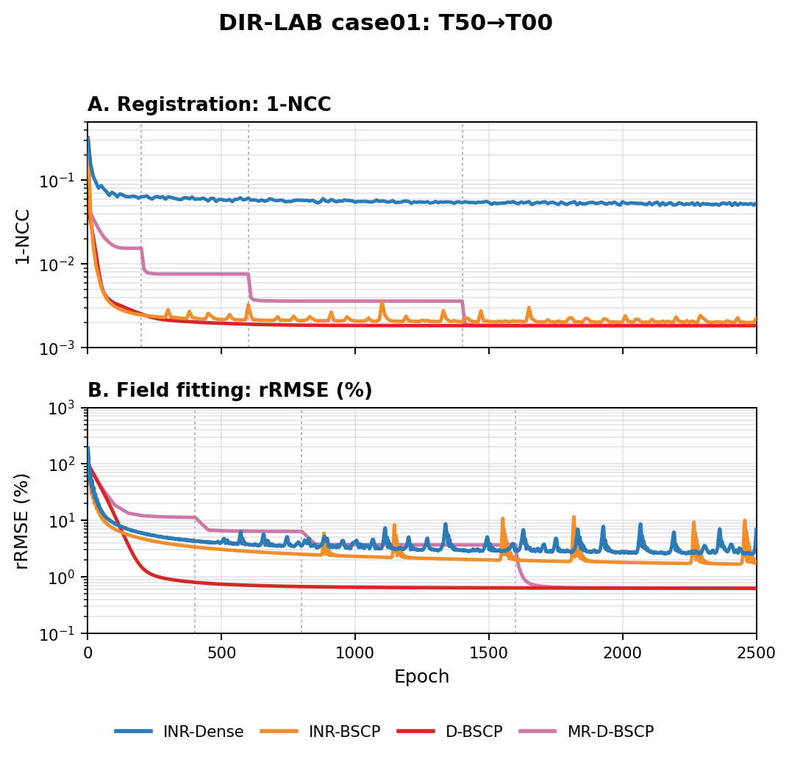</a>
    </td>
    <td align="center" width="20%">
      <strong>DIR-LAB case02: T50→T00</strong> 
      <a href="diagnostic_figures/dirlab_case02_diagnostics.png">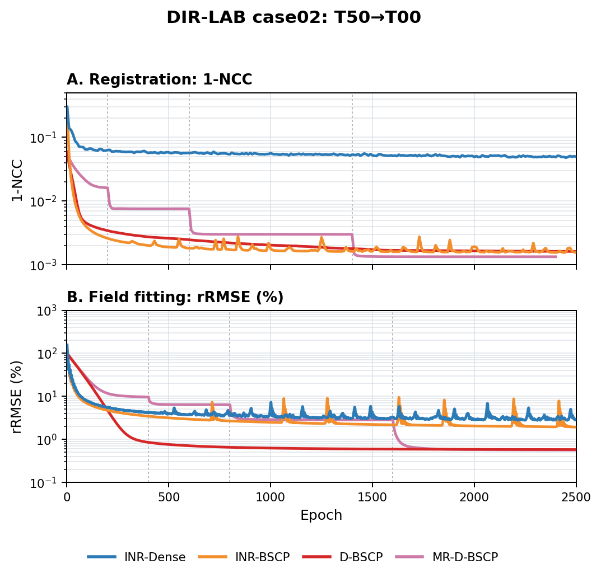</a>
    </td>
    <td align="center" width="20%">
      <strong>DIR-LAB case03: T50→T00</strong> 
      <a href="diagnostic_figures/dirlab_case03_diagnostics.png">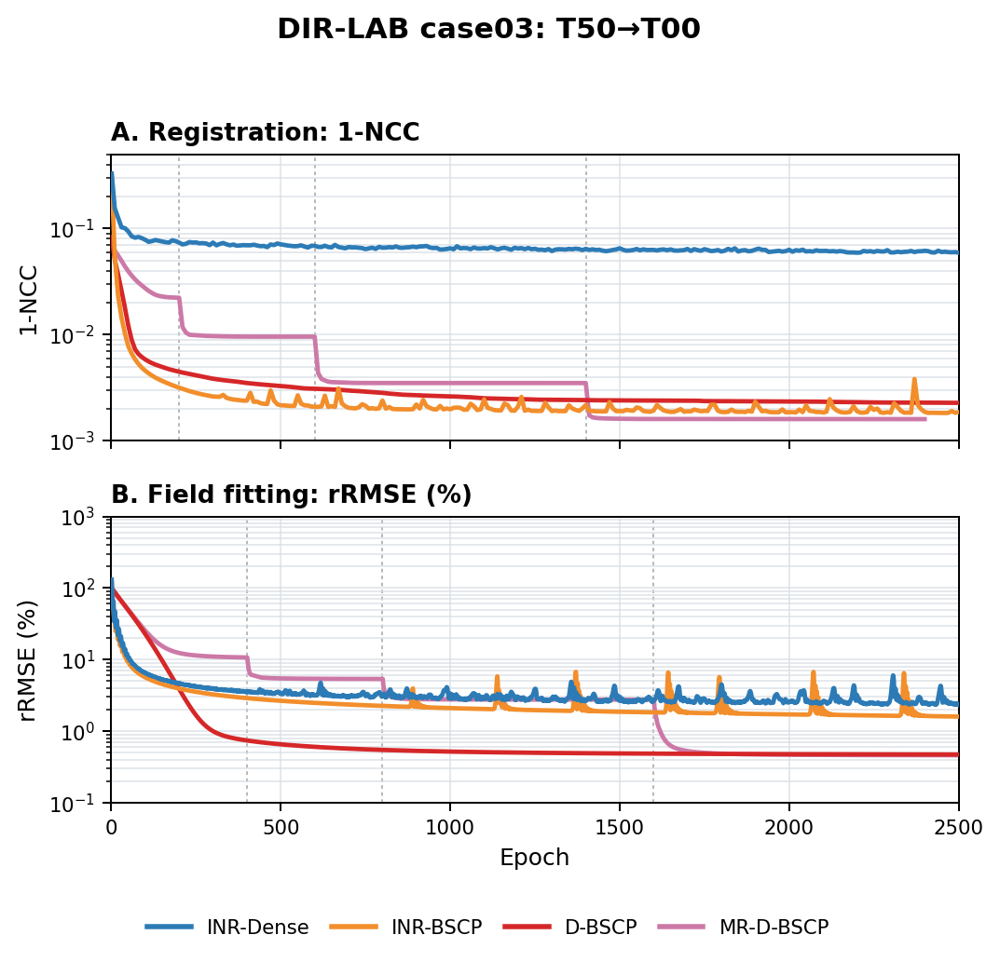</a>
    </td>
    <td align="center" width="20%">
      <strong>DIR-LAB case04: T50→T00</strong> 
      <a href="diagnostic_figures/dirlab_case04_diagnostics.png">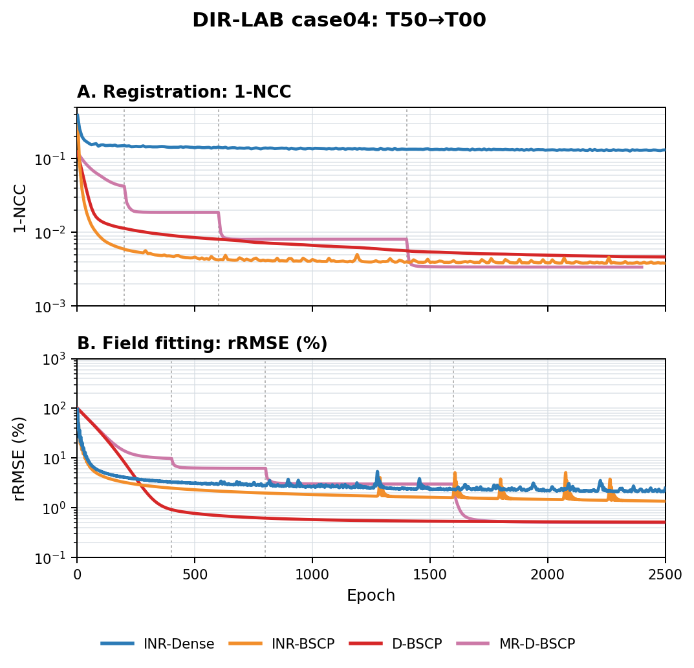</a>
    </td>
    <td align="center" width="20%">
      <strong>DIR-LAB case05: T50→T00</strong> 
      <a href="diagnostic_figures/dirlab_case05_diagnostics.png">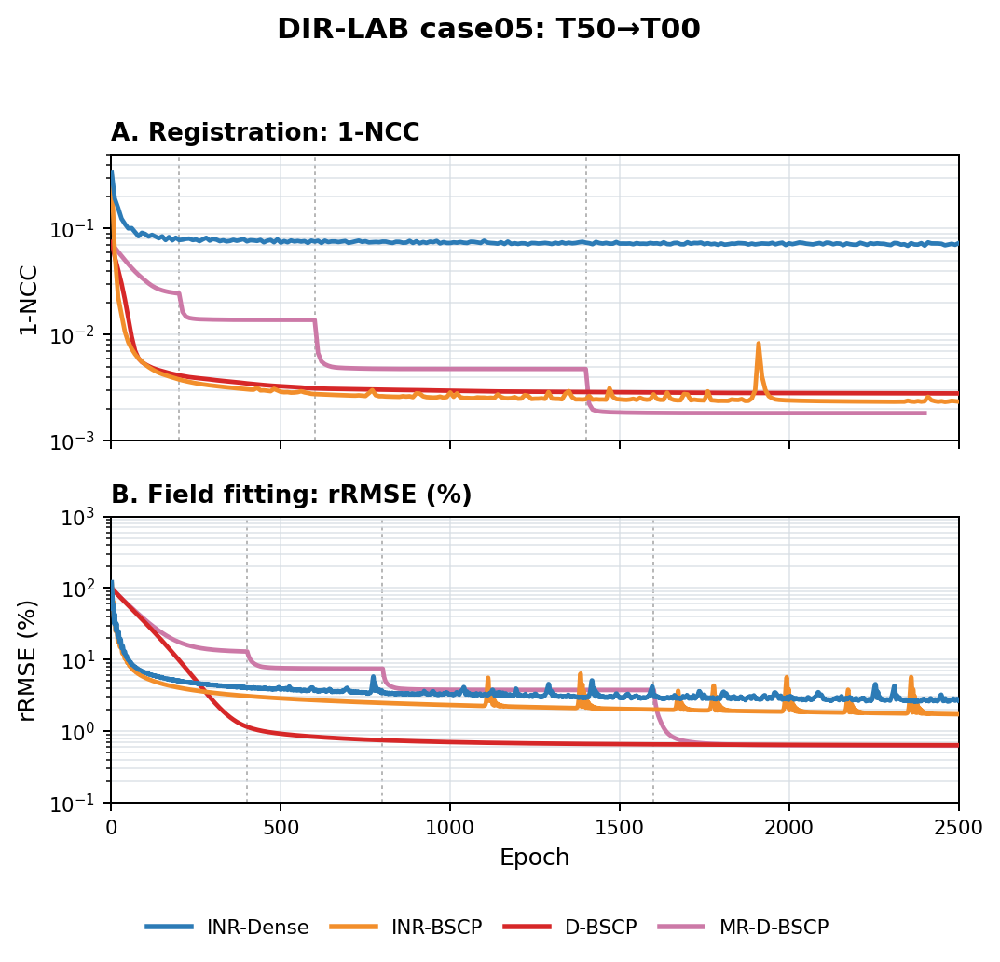</a>
    </td>
  </tr>
  <tr>
    <td align="center" width="20%">
      <strong>DIR-LAB case06: T50→T00</strong> 
      <a href="diagnostic_figures/dirlab_case06_diagnostics.png">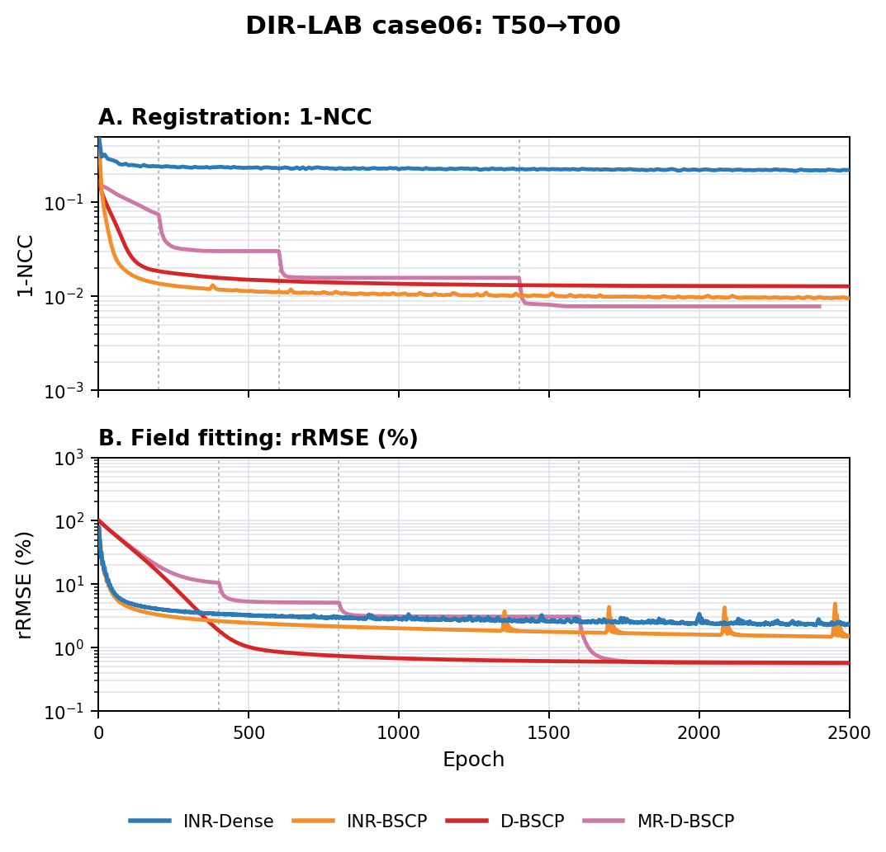</a>
    </td>
    <td align="center" width="20%">
      <strong>DIR-LAB case07: T50→T00</strong> 
      <a href="diagnostic_figures/dirlab_case07_diagnostics.png">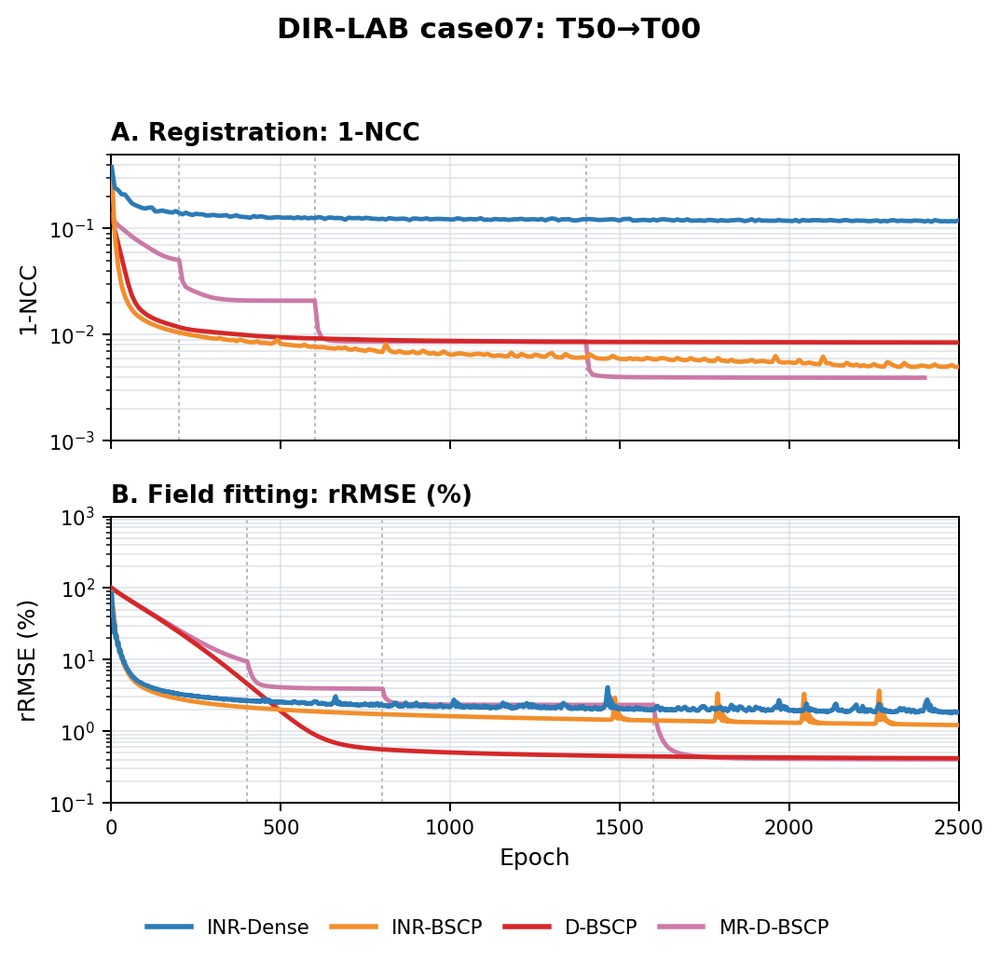</a>
    </td>
    <td align="center" width="20%">
      <strong>DIR-LAB case08: T50→T00</strong> 
      <a href="diagnostic_figures/dirlab_case08_diagnostics.png">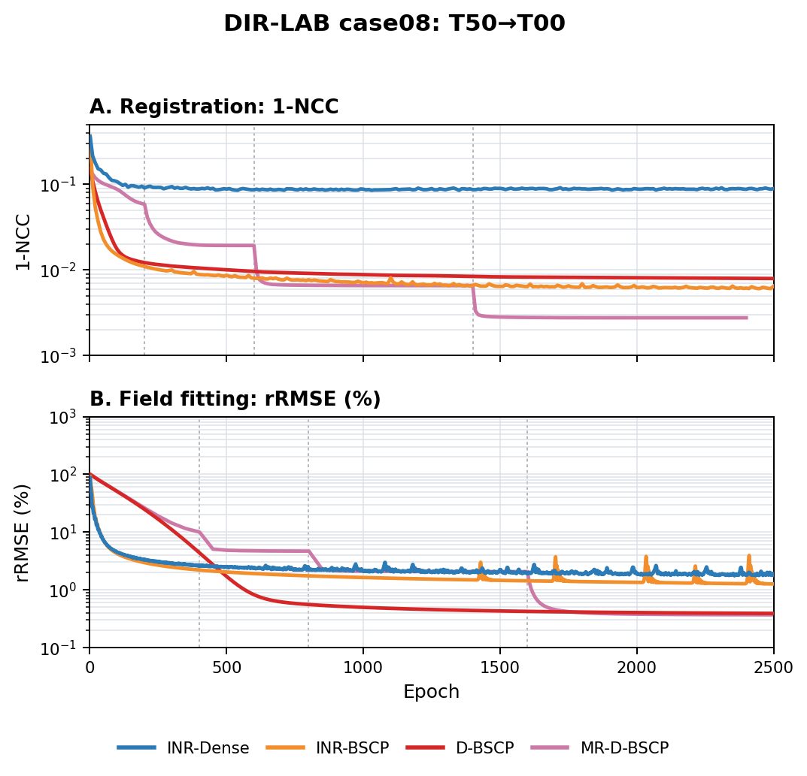</a>
    </td>
    <td align="center" width="20%">
      <strong>DIR-LAB case09: T50→T00</strong> 
      <a href="diagnostic_figures/dirlab_case09_diagnostics.png">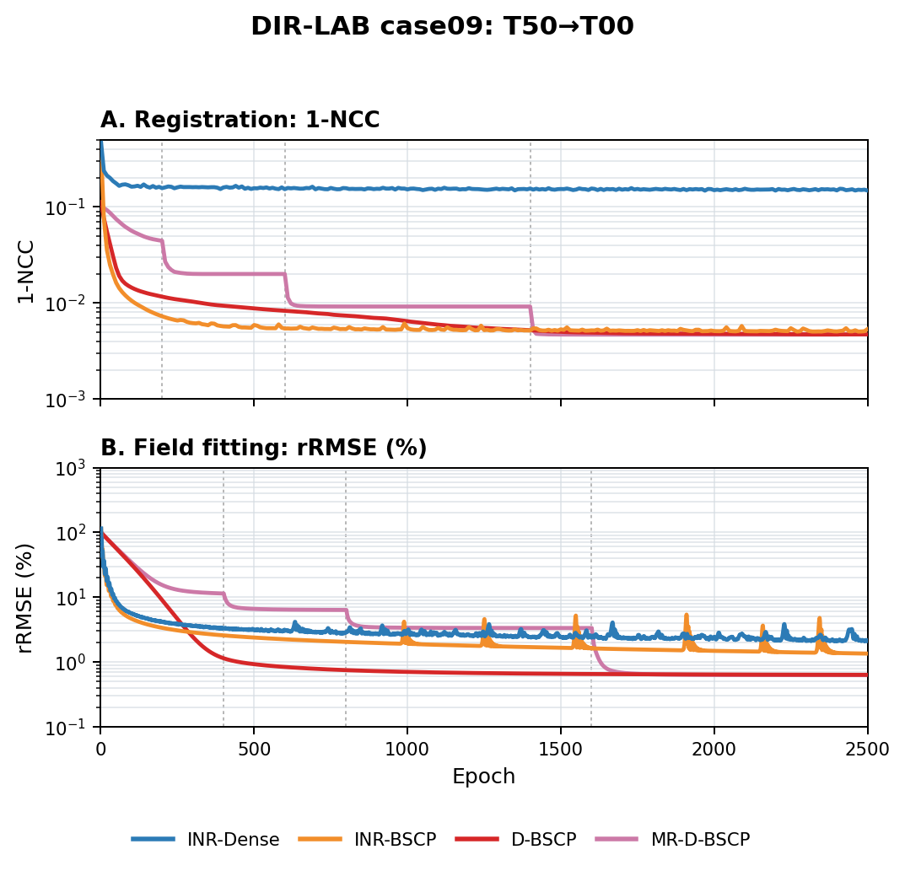</a>
    </td>
    <td align="center" width="20%">
      <strong>DIR-LAB case10: T50→T00</strong> 
      <a href="diagnostic_figures/dirlab_case10_diagnostics.png">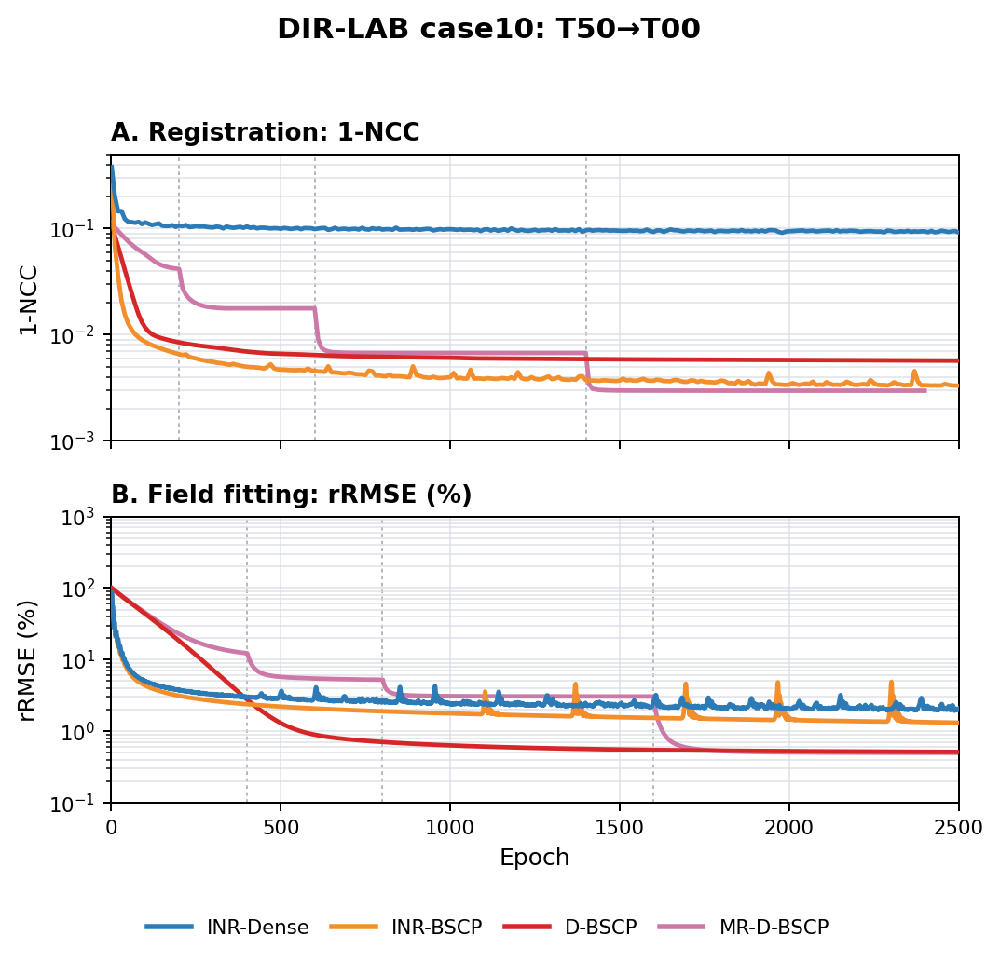</a>
    </td>
  </tr>
</table>

### Panel A endpoints: 1-NCC

| Case | INR-Dense | INR-BSCP | D-BSCP | MR-D-BSCP |
|---|---:|---:|---:|---:|
| DIR-LAB case01: T50→T00 | 0.05359 | 0.00224 | 0.001838 | 0.00184 |
| DIR-LAB case02: T50→T00 | 0.04976 | 0.001562 | 0.001622 | 0.001341 |
| DIR-LAB case03: T50→T00 | 0.05923 | 0.001863 | 0.002278 | 0.0016 |
| DIR-LAB case04: T50→T00 | 0.1317 | 0.003806 | 0.004649 | 0.003379 |
| DIR-LAB case05: T50→T00 | 0.07274 | 0.002344 | 0.002797 | 0.001822 |
| DIR-LAB case06: T50→T00 | 0.2229 | 0.009587 | 0.01281 | 0.007831 |
| DIR-LAB case07: T50→T00 | 0.1195 | 0.004986 | 0.008444 | 0.003931 |
| DIR-LAB case08: T50→T00 | 0.0895 | 0.006449 | 0.007951 | 0.00276 |
| DIR-LAB case09: T50→T00 | 0.1484 | 0.005347 | 0.004712 | 0.004689 |
| DIR-LAB case10: T50→T00 | 0.09195 | 0.003307 | 0.005688 | 0.002965 |

### Panel B endpoints: rRMSE (%)

| Case | INR-Dense | INR-BSCP | D-BSCP | MR-D-BSCP |
|---|---:|---:|---:|---:|
| DIR-LAB case01: T50→T00 | 6.978 | 1.748 | 0.629 | 0.624 |
| DIR-LAB case02: T50→T00 | 2.943 | 1.928 | 0.578 | 0.566 |
| DIR-LAB case03: T50→T00 | 2.359 | 1.604 | 0.473 | 0.462 |
| DIR-LAB case04: T50→T00 | 2.469 | 1.352 | 0.515 | 0.507 |
| DIR-LAB case05: T50→T00 | 2.679 | 1.724 | 0.637 | 0.628 |
| DIR-LAB case06: T50→T00 | 2.321 | 1.502 | 0.577 | 0.563 |
| DIR-LAB case07: T50→T00 | 1.854 | 1.217 | 0.419 | 0.405 |
| DIR-LAB case08: T50→T00 | 1.799 | 1.263 | 0.391 | 0.369 |
| DIR-LAB case09: T50→T00 | 2.122 | 1.349 | 0.635 | 0.628 |
| DIR-LAB case10: T50→T00 | 2.056 | 1.316 | 0.514 | 0.499 |

## Validation and provenance

All 160 plotted trajectories passed endpoint agreement against the accepted population optimization index. The comparison combines 136 population runs with 24 exact-compatible source-backed reuses from the original three-case figure.

- Curve-level sources, metrics, point counts, extrema, and endpoint checks: [`diagnostic_curve_summary.csv`](diagnostic_curve_summary.csv)
- Shared axis definitions and generation metadata: [`diagnostic_manifest.json`](diagnostic_manifest.json)
- Accepted run index: [`optimization_index.csv`](optimization_index.csv)
- Protocol and cohort provenance: [`experiment_protocol.md`](experiment_protocol.md)
- Reproducible generator: [`plot_case_diagnostics.py`](../../scripts/experiments/fit_modes_population/plot_case_diagnostics.py)

These diagnostics support case-by-case optimization review. Population claims should use the accepted endpoint statistics and paired population analysis rather than visual curve inspection alone.
