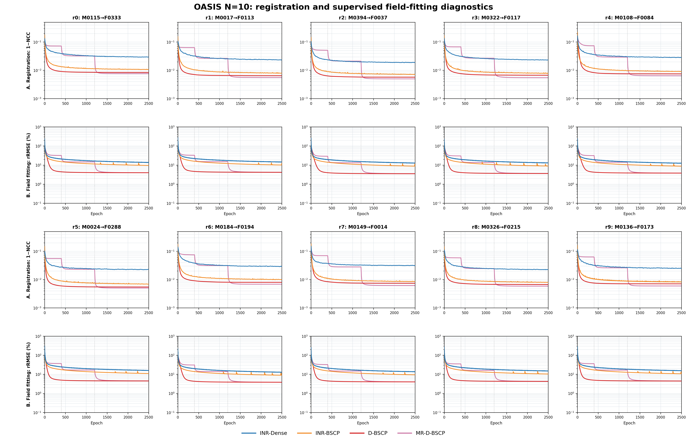
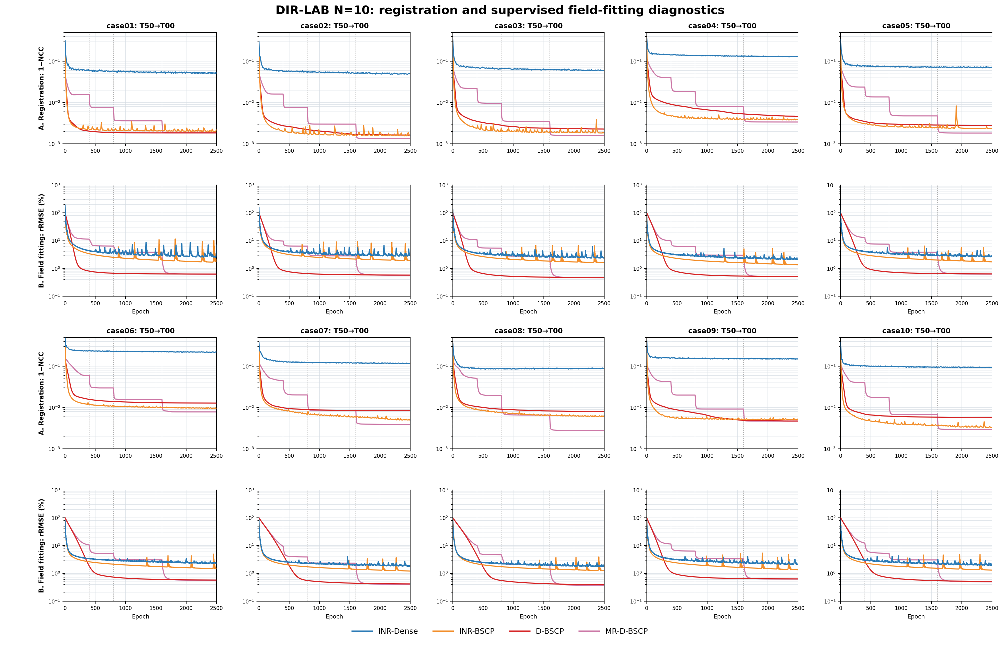

# Schedule-Matched Population Diagnostic Figures

These source-backed figures are supplementary/reviewer diagnostics, not the final compact main-paper figure.

The camera-ready source index preserves 150 accepted population records and replaces only the ten DIR-LAB Panel A MR-D-BSCP records with the accepted `400/400/800/900` schedule refresh.

## Shared axes

- Panel A: registration `1−NCC`, log range `1e-3–5e-1`.
- Panel B: supervised target-field fitting `rRMSE (%)`, log range `1e-1–1e3`.
- Every subplot uses epochs `0–2500` with 500-epoch ticks.
- The same Panel A and Panel B definitions are used across both datasets and all cases.
- Gray dotted lines indicate MR-D-BSCP stage transitions only.

## OASIS N=10

### Panel A endpoints: 1−NCC

| Case | INR-Dense | INR-BSCP | D-BSCP | MR-D-BSCP |
|---|---:|---:|---:|---:|
| OASIS r0: M0115→F0333 | 0.02934 | 0.01076 | 0.008459 | 0.007664 |
| OASIS r1: M0017→F0113 | 0.02324 | 0.007977 | 0.006487 | 0.005574 |
| OASIS r2: M0394→F0037 | 0.01882 | 0.007177 | 0.005743 | 0.005014 |
| OASIS r3: M0322→F0117 | 0.02354 | 0.00794 | 0.006723 | 0.005506 |
| OASIS r4: M0108→F0084 | 0.02841 | 0.00908 | 0.00752 | 0.00645 |
| OASIS r5: M0024→F0288 | 0.02308 | 0.00702 | 0.005483 | 0.00503 |
| OASIS r6: M0184→F0194 | 0.02881 | 0.01012 | 0.008026 | 0.006898 |
| OASIS r7: M0149→F0014 | 0.03125 | 0.008748 | 0.00744 | 0.006174 |
| OASIS r8: M0326→F0215 | 0.02266 | 0.00793 | 0.006702 | 0.005883 |
| OASIS r9: M0136→F0173 | 0.02498 | 0.008296 | 0.007105 | 0.005965 |

### Panel B endpoints: rRMSE (%)

| Case | INR-Dense | INR-BSCP | D-BSCP | MR-D-BSCP |
|---|---:|---:|---:|---:|
| OASIS r0: M0115→F0333 | 13.791 | 9.638 | 3.987 | 4.000 |
| OASIS r1: M0017→F0113 | 14.553 | 10.253 | 4.198 | 4.217 |
| OASIS r2: M0394→F0037 | 12.817 | 9.863 | 3.534 | 3.550 |
| OASIS r3: M0322→F0117 | 13.052 | 8.936 | 3.632 | 3.646 |
| OASIS r4: M0108→F0084 | 12.596 | 8.799 | 3.814 | 3.828 |
| OASIS r5: M0024→F0288 | 16.116 | 11.094 | 4.506 | 4.536 |
| OASIS r6: M0184→F0194 | 12.985 | 9.056 | 3.874 | 3.887 |
| OASIS r7: M0149→F0014 | 13.754 | 9.491 | 4.035 | 4.058 |
| OASIS r8: M0326→F0215 | 15.074 | 10.434 | 4.278 | 4.303 |
| OASIS r9: M0136→F0173 | 15.618 | 11.417 | 4.474 | 4.503 |

## DIR-LAB N=10

### Panel A endpoints: 1−NCC

| Case | INR-Dense | INR-BSCP | D-BSCP | MR-D-BSCP |
|---|---:|---:|---:|---:|
| DIR-LAB case01: T50→T00 | 0.05359 | 0.00224 | 0.001838 | 0.00184 |
| DIR-LAB case02: T50→T00 | 0.04976 | 0.001562 | 0.001622 | 0.001341 |
| DIR-LAB case03: T50→T00 | 0.05923 | 0.001863 | 0.002278 | 0.0016 |
| DIR-LAB case04: T50→T00 | 0.1317 | 0.003806 | 0.004649 | 0.003379 |
| DIR-LAB case05: T50→T00 | 0.07274 | 0.002344 | 0.002797 | 0.001822 |
| DIR-LAB case06: T50→T00 | 0.2229 | 0.009587 | 0.01281 | 0.007831 |
| DIR-LAB case07: T50→T00 | 0.1195 | 0.004986 | 0.008444 | 0.003924 |
| DIR-LAB case08: T50→T00 | 0.0895 | 0.006449 | 0.007951 | 0.002761 |
| DIR-LAB case09: T50→T00 | 0.1484 | 0.005347 | 0.004712 | 0.004689 |
| DIR-LAB case10: T50→T00 | 0.09195 | 0.003307 | 0.005688 | 0.002965 |

### Panel B endpoints: rRMSE (%)

| Case | INR-Dense | INR-BSCP | D-BSCP | MR-D-BSCP |
|---|---:|---:|---:|---:|
| DIR-LAB case01: T50→T00 | 6.978 | 1.748 | 0.629 | 0.624 |
| DIR-LAB case02: T50→T00 | 2.943 | 1.928 | 0.578 | 0.566 |
| DIR-LAB case03: T50→T00 | 2.359 | 1.604 | 0.473 | 0.462 |
| DIR-LAB case04: T50→T00 | 2.469 | 1.352 | 0.515 | 0.507 |
| DIR-LAB case05: T50→T00 | 2.679 | 1.724 | 0.637 | 0.628 |
| DIR-LAB case06: T50→T00 | 2.321 | 1.502 | 0.577 | 0.563 |
| DIR-LAB case07: T50→T00 | 1.854 | 1.217 | 0.419 | 0.405 |
| DIR-LAB case08: T50→T00 | 1.799 | 1.263 | 0.391 | 0.369 |
| DIR-LAB case09: T50→T00 | 2.122 | 1.349 | 0.635 | 0.628 |
| DIR-LAB case10: T50→T00 | 2.056 | 1.316 | 0.514 | 0.499 |

## Validation and provenance

- `160/160` trajectories passed endpoint agreement.
- `10/10` refreshed DIR-LAB curves contain 251 finite full-crop diagnostics ending at epoch 2500.
- `150/150` nonreplacement source-index rows are unchanged.
- Individual case figures are under `case_figures/`.
- Machine-readable sources and checks are in `camera_ready_source_index.csv`, `curve_summary.csv`, `replacement_audit.csv`, `validation_report.json`, and `figure_manifest.json`.

The historical 2400-epoch index and figures remain immutable sensitivity evidence.
