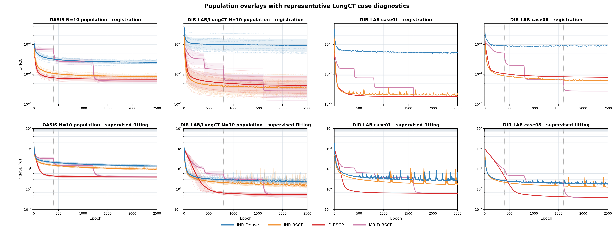
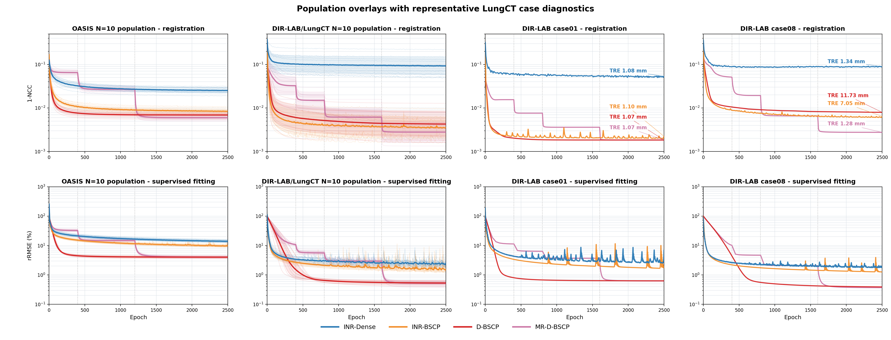
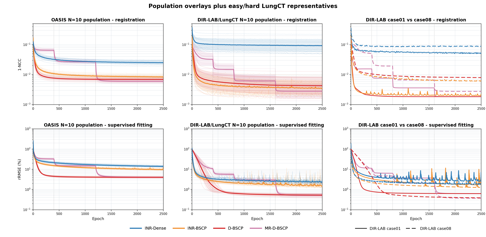

# Population Overlay Design Trials

These are exploratory supplementary/reviewer design candidates, not the locked compact main-paper figure.

## 2x4: population plus separate LungCT cases

This wider design prioritizes readability: OASIS population, LungCT population, DIR-LAB case01, and DIR-LAB case08 each receive their own column.

## 2x4 with case TRE labels

This version adds final registration TRE labels only to the DIR-LAB case01 and case08 registration panels. The labels use common `tre_snap_to_voxel.tre_mean_mm` for all four methods, are displayed with two decimals, and are anchored in nearby whitespace with leader lines to the final curve endpoints.

## 2x3: population plus combined LungCT cases

This compact design prioritizes space: the final column overlays case01 and case08, using method color and case line style.

## Encoding

- Rows are Panel A registration `1-NCC` and Panel B supervised fitting `rRMSE (%)`.
- Population columns use thin individual case curves, thick log-space means, and log-space +/-1 SD bands.
- Case-specific columns use the same four method colors and method order as the existing diagnostic figures.
- TRE labels, when shown, are method-colored and attached only to the case01/case08 registration panels.
- In the 2x3 combined column, case01 is solid and case08 is dashed.

## Validation

- Source trajectories loaded: `160/160`.
- Dataset/panel/method groups with ten cases: `16/16`.
- Endpoint-matched trajectories: `160/160`.
- DIR-LAB case01 curves: `8/8`.
- DIR-LAB case08 curves: `8/8`.
- DIR-LAB case01/case08 registration TRE labels: `8/8`.
- DIR-LAB Panel A MR-D-BSCP refresh curves: `10/10`.

## Files

- Machine-readable design manifest: [`population_overlay_design_trials_manifest.json`](population_overlay_design_trials_manifest.json)

## Reading note

The 2x4 is probably better for supplement/reviewer explanation. The 2x3 is probably the more realistic compact candidate if the main paper needs one figure panel for this story.
