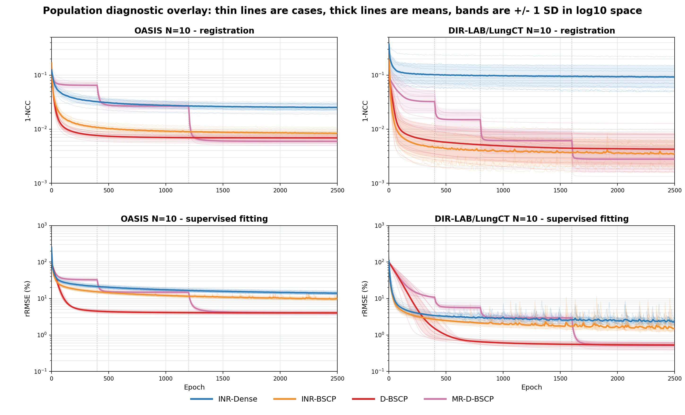

# Population Overlay Mean/Std Trial Figure

This is an exploratory supplementary/reviewer diagnostic, not the compact main-paper figure.

## Encoding

- Columns compare OASIS N=10 and DIR-LAB/LungCT N=10.
- Rows compare Panel A registration `1-NCC` and Panel B supervised fitting `rRMSE (%)`.
- Thin colored lines are the ten individual case trajectories for a method.
- Thick colored lines are population means.
- Shaded bands are mean plus/minus one sample standard deviation computed in `log10(metric)` space and then back-transformed.

## Validation

- Source trajectories loaded: `160/160`.
- Dataset/panel/method groups with ten cases: `16/16`.
- Endpoint-matched trajectories: `160/160`.
- DIR-LAB Panel A MR-D-BSCP refresh curves: `10/10`, all with 251 points through epoch 2500.
- Aggregate grid points per group: `251`.

## Files

- Aggregate curve table: [`population_overlay_mean_std_summary.csv`](population_overlay_mean_std_summary.csv)
- Machine-readable manifest: [`population_overlay_mean_std_manifest.json`](population_overlay_mean_std_manifest.json)

## Reading note

This view is expected to be most interpretable for OASIS, where the ten cases are more visually coherent. For LungCT, the same figure is useful as a heterogeneity check, but method conclusions should still come from casewise and paired statistics.
